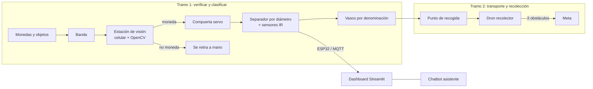

# Sistema logístico de monedas inteligentes

Universidad Militar Nueva Granada (UMNG), clase de microcontroladores.

Autores: Lina María Moreno Ospina y Bryan Andrey Martinez Montaño.

Este repositorio es la **entrega de avance**. Muestra la idea completa del sistema,
qué partes ya funcionan con evidencia, qué falta y cómo se va a completar.

## 1. La idea en una página

Una planta de monedas en pequeño. Las monedas llegan mezcladas con otros objetos por una banda. El sistema:

1. **Verifica** con visión computacional si lo que llega es una moneda y deja pasar solo las monedas.
2. **Clasifica y cuenta** las monedas por denominación con un separador mecánico por diámetro y sensores infrarrojos.
3. **Transporta** los vasos ya clasificados hasta un punto de recogida.
4. **Recolecta** los vasos con un **dron** que sigue una trayectoria con 3 obstáculos hasta la meta.
5. **Muestra** todo en un **dashboard web** (cantidad, valor, peso y ruta) y responde preguntas con un **chatbot**.



## 2. Estado por módulo

✅ terminado y probado · 🟡 parcial · ⬜ pendiente

| # | Módulo | Estado | Evidencia / qué falta |
|---|---|---|---|
| 1 | Verificación moneda vs. no moneda (visión) | ✅ | reconoce monedas nuevas $50–$1000 con celular como cámara; `vision/` y video de reconocimiento |
| 2 | Compuerta: servo + sensor IR + ESP32 | ✅ | abre con moneda, queda cerrada con objeto; `firmware/estacion_manual/` y video de funcionamiento |
| 3 | Banda transportadora | ✅ | banda armada, manual con interruptor (el L298N no funcionó) |
| 4 | Dashboard Streamlit + MQTT | 🟡 | funciona con el simulador; falta conectar la ESP32 real |
| 5 | Chatbot asistente | ✅ | responde sobre el proyecto, sin internet; `chatbot/` y video del chatbot |
| 6 | Separador por diámetro + conteo IR | 🟡 | separador diseñado e impreso; firmware escrito; falta integrarlo y medir aciertos |
| 7 | Integración compuerta + separador + dashboard | ⬜ | un solo flujo de punta a punta |
| 8 | Dron: control desde el computador | 🟡 | despegar, aterrizar y stop validados (`dron/`); falta derecha/izquierda confirmados en vuelo |
| 9 | Dron: recolección y 3 obstáculos | ⬜ | diseño en la simulación PyBullet; falta el vuelo real |
| 10 | Visión en vuelo (obstáculos vs. otros objetos) | ⬜ | falta verificar el video del dron (RTSP) |
| 11 | Pruebas con tablas de aciertos | ⬜ | protocolo listo en `pruebas/` |

## 3. Qué ya se puede ver funcionando

**Estación de verificación (módulos 1–3)**
1. La moneda llega por la banda y el sensor IR la detecta frente a la compuerta.
2. La ESP32 avisa por USB; el computador pide la foto al celular (IP Webcam), la analiza y responde.
3. Moneda: el servo abre y la moneda pasa. No moneda: la compuerta queda cerrada.

La moneda se acepta solo si se ve como disco (borde circular), mide entre 16 y 28 mm, tiene color metálico y no
tiene agujero. Probado con monedas nuevas de $50, $100, $200, $500 y $1000.

**Cómo correrlo**
```
pip install opencv-python numpy pyserial
# subir firmware/estacion_manual/estacion_manual.ino a la ESP32 (ESP32 Dev Module, librería ESP32Servo)
python vision/reconocimiento_monedas.py --url http://IP_DEL_CELULAR:8080/shot.jpg --config config_celular.json --elegir-roi
python vision/reconocimiento_monedas.py --url http://IP_DEL_CELULAR:8080/shot.jpg --config config_celular.json --calibrar 22.4
python vision/reconocimiento_monedas.py --url http://IP_DEL_CELULAR:8080/shot.jpg --config config_celular.json --serie COM4
```

**Dashboard con chatbot**
```
pip install streamlit paho-mqtt pandas
python dashboard/simulador_esp32.py          # en otra terminal: hace de ESP32
streamlit run dashboard/dashboard_streamlit.py
```

## 4. Decisiones de diseño tomadas hasta ahora

| Decisión | Motivo |
|---|---|
| Separador mecánico por diámetro en vez de celda de carga | la celda de carga era muy complicada |
| Banda en dos tramos y dron recolector | corrección del profesor |
| Servo como **compuerta** en la estación de la cámara | la banda es muy alta para expulsar objetos |
| Solo monedas **nuevas** | no se lograba separar antiguas de nuevas (en particular $500) |
| Banda **manual** con interruptor | el puente H L298N no funcionó |
| **Celular** como cámara | la ESP32-CAM dejó de arrancar (`frame buffer malloc failed`) |
| Detección por **borde circular** (Hough) | la moneda tiene casi el brillo de la banda oscura |

## 5. Qué falta para la entrega final

Plan en tres bloques (las fechas se fijan con el profesor):

1. **Integrar el tramo 1:** compuerta + separador + sensores IR + dashboard por MQTT, un solo flujo.
2. **Pruebas:** repetir cada denominación y cada tipo de objeto y llenar las tablas de `pruebas/`.
3. **Dron:** confirmar derecha/izquierda, hacer la trayectoria con 3 obstáculos y, si el video RTSP funciona, la
   detección de obstáculos.

Riesgos principales: la IP del celular cambia entre conexiones; la cámara y la luz deben quedar fijas; el dron se
maneja con su control remoto por seguridad, así que la parte autónoma es la más incierta.

## 6. Estructura del repositorio

| Carpeta | Contenido |
|---|---|
| `docs/` | requisitos y arquitectura, estado y plan, problemas resueltos |
| `vision/` | reconocimiento de monedas con OpenCV |
| `firmware/estacion_manual/` | compuerta: servo + IR + diálogo con el computador |
| `firmware/contador_monedas/` | conteo por denominación con IR y MQTT (por probar) |
| `firmware/camara_esp32cam/` | sketch de la ESP32-CAM (descartada) |
| `dashboard/` | Streamlit (con pestaña del asistente) y simulador MQTT |
| `chatbot/` | asistente del proyecto |
| `dron/` | demostración de control del dron |
| `simulacion/` | PyBullet: fábrica y dron |
| `electrico/`, `mecanico/` | pines, conexiones, medidas, plano y guía de armado del separador |
| `pruebas/`, `avance/` | protocolo de pruebas y plan por partes |

Fuentes de las medidas de las monedas: Banco de la República ([$100](https://banrep.gov.co/es/billetes-monedas/moneda-100-pesos),
[$200](https://www.banrep.gov.co/en/banknotes-coins/200-peso-coin), [$500](https://banrep.gov.co/es/billetes-monedas/moneda-500-pesos)).
